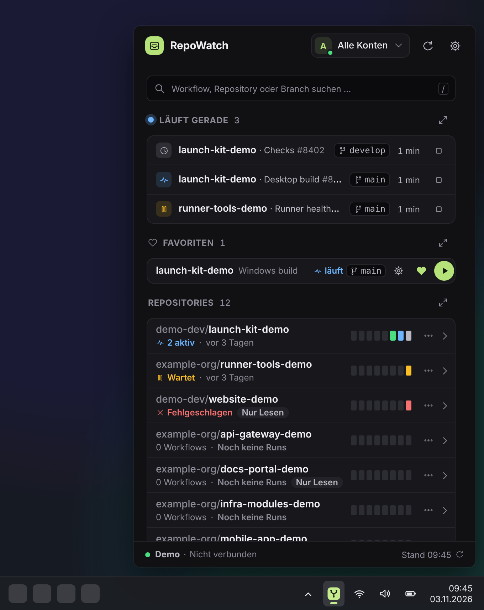
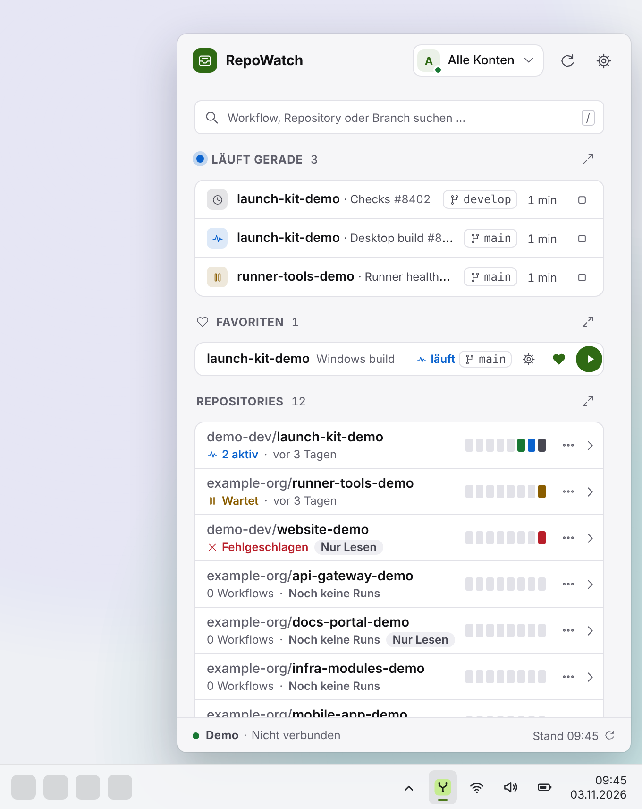

# RepoWatch

[](https://github.com/fo0/repo-watch/actions/workflows/release.yml)
[](https://github.com/fo0/repo-watch/actions/workflows/release.yml)


**GitHub Actions within reach.** RepoWatch is a compact Windows tray companion for monitoring runs, launching workflows and keeping frequently used launches as pinned templates.

Built with **Tauri 2, Rust, Svelte 5 and TypeScript**. Windows x64 is the primary target; other desktop platforms require their own native validation.

| Dark                                                                                                                                                                                               | Light                                                                                                                                                                                                 |
| -------------------------------------------------------------------------------------------------------------------------------------------------------------------------------------------------- | ----------------------------------------------------------------------------------------------------------------------------------------------------------------------------------------------------- |
|  |  |

<sub>Browser demo with synthetic example data on an illustrative taskbar; regenerate with `pnpm capture:readme`.</sub>

## What it does

- **A panel beside the tray icon.** Windows placement follows the clicked icon, monitor work area and DPI. Clicking outside hides the panel while preserving open forms and ongoing work. Closing the window keeps RepoWatch in the tray; **RepoWatch beenden** in the tray menu exits it.
- **Optional Windows login startup.** Enable **Einstellungen → App → Mit Windows starten** and **Speichern** to launch directly in the tray after user login. It is off by default, reads the Windows registration and respects Windows' startup veto. Manual launches still open the panel. See [setup, updates and validation](docs/WINDOWS_AUTOSTART.md).
- **One overview, no tabs.** Below the search, **Läuft gerade** lists the running, queued and waiting runs (repository first, then workflow and run ID), **Favoriten** the saved favorites as single-line rows with the repository name first and the favorite's name small beside it (the name opens the stored configuration, the gear edits its default branch and inputs, the heart removes and the play button on the far right starts at once — or opens the start dialog when an input is missing; the account is in the tooltip), and **Repositories** ordered by their most recent activity (latest run or push, re-sorted on every refresh), each with its open runs (**2 aktiv**) or latest status, when it last ran (**vor 2 Std.**, **vor 3 Tagen**, then the date) and a strip of its last 8 runs (newest on the right); workflow rows and favorites show their own last run or **läuft**. The search filters all three and also finds the account's repositories outside the automatic ones: expanding one loads its workflows for the session, so they can be started or saved as a favorite ([ADR-0006](docs/adr/0006-search-reaches-every-repository.md)). Expand a repository to see its default branch and last push with a **GitHub** button that opens it, and to configure or start a workflow, or save its default configuration with the heart button. A click on a running run opens it in the **Verlauf**; its stop button cancels it after a second click (**Abbrechen?**), and the run reads **Wird abgebrochen** until GitHub reports it closed.
- **Maximize a section.** Every section header has a maximize button that fills the panel with that section: **Verlauf** (every open run and the latest 50 completed runs, with filters), **Favoriten** (all favorites and **Workflow starten …**) and **Repositories** (the full list). The overview shows at most 3 running runs, 4 favorites and 10 repositories; **+N weitere** opens the rest, and a search shows every match. On a maximized section the same button, now a back arrow (**Zurück zur Übersicht**), **Esc** or a click on the brand **RepoWatch** returns; on the overview the brand clears the search. Completed runs stay cached; status polling follows open runs until their final state and discovers newly created runs. The **Verlauf** lists open runs under **Jetzt** and the completed history under **Abgeschlossen**; each row shows the status as a coloured icon tile and as text with a dot, the repository name first (the owner is in the tooltip), then the workflow with its run ID and the branch. Open runs count up (**seit 3 min**), completed ones read relative (**gerade eben**, **vor 3 Min.**, **gestern**) with their duration; times tick once a minute and the exact time is in the tooltip. Expanding a row shows its details with **Auf GitHub öffnen**, **Link kopieren** and, for an open run with write access, **Run abbrechen**.
- **Repositories without setup.** RepoWatch picks them itself: per account the 10 repositories with the latest push plus every repository with a favorite, recomputed whenever that account's repository listing arrives — no picker, nothing to add ([ADR-0003](docs/adr/0003-automatic-repositories.md)). A repository that pushes all the time can be hidden: it leaves the lists and the run lists, the next one moves up, and a favorite in it keeps working; **Einstellungen → App → Ausgeblendete Repositories** brings it back ([ADR-0008](docs/adr/0008-hidden-repositories.md)). Each repository row has a **⋯** menu (also on right click): **Letzten Run auf GitHub öffnen**, **Link kopieren** (the repository page) and **Ausblenden** (with **Rückgängig**; in a search a hidden repository offers **Einblenden**). Natively the overview shows the active account's repositories.
- **Keyboard first.** **F5** or **Ctrl+R** refreshes the panel instead of reloading it, **Ctrl+1/2/3** maximize **Repositories**, **Verlauf** and **Favoriten** (the same key returns to the overview), **/** or **Ctrl+F** focuses the search (**Ctrl+F** also selects the query to retype it), **Ctrl+,** opens **Einstellungen** and **Esc** clears or leaves the search, closes a menu or dialog, then returns from a maximized section. The search field's **Tastenkürzel** hint lists them. In the search, **↓** moves focus to the first result.
- **Explicit workflow launches.** Choose a workflow, branch/tag and typed inputs. Save account-bound favorites; a complete favorite starts with one click, an uncertain start keeps it locked until released in the start dialog. A disabled start button names its one reason in its tooltip (for example **Kein Schreibzugriff auf dieses Repository** or **Offline – Starts sind deaktiviert**). Removing a favorite offers **Rückgängig** for 8 seconds.
- **Deliberate account selection.** On first launch, **GitHub-Konto verbinden** opens the connection dialog; after a successful connection it closes by itself, **Konto <login> verbunden.** confirms it and a new account's repositories appear on the overview. Further accounts are added with **Einstellungen → Konten → Konto hinzufügen**. Choose the active credential in the account menu at the top of the panel (at once) or under **Einstellungen → Konten → Aktives Konto** (with **Speichern**). The app remembers its stable nonsecret ID, distinguishes same-login sources and asks for a new selection if it disappears. It never silently falls back to another identity.
- **Cached state and uncertain-start protection.** Offline views keep cached activity. Ambiguous dispatch responses remain quarantined across reopening and restart to avoid blindly starting the same workflow twice; only **Sperre aufheben…** with an explicit confirmation releases the lock, and releasing never starts anything. An accepted dispatch is not a successful build.
- **Calm, accessible notices and styling.** Plain success notices close after 3 seconds, hovered or not; a notice with an action (**Rückgängig** after 8 s, **Im Verlauf anzeigen** after 3 s) waits while hovered or focused, until the window loses focus or hides. No notice closes while a dialog is open. Warnings and errors stay until closed. Metadata text meets WCAG AA contrast, keyboard focus has visible rings, and Windows High Contrast (forced colors) redraws state with system colors.
- **Refresh interval.** **Einstellungen → App → Aktualisierung** sets how often idle repositories are read: a slider over 15 s to 30 min (1 min recommended and default) or **Eigener Wert** in seconds (15–3600), applied with **Speichern**. Open runs are still followed every 15 s, and **F5** reads every repository at once; the repository list and push times follow the interval but at most once a minute; branches, tags and workflows refresh every 10 minutes.
- **Light and dark.** The panel follows the light or dark setting of the operating system; **Einstellungen → App → Darstellung** overrides it with **Hell** or **Dunkel** (or back to **System**). A choice previews at once and stays only with **Speichern**; it is remembered on this device.
- **German or English.** The app speaks the system language — German on a German Windows, English otherwise; **Einstellungen → App → Sprache** (**Settings → App → Language**) picks **Deutsch** or **English** instead. Panel, run notifications, tray menu and error messages follow the choice; it is remembered on this device.
- **In-app updates.** Standard releases publish an unsigned Windows EXE without extra signing configuration. RepoWatch checks at startup, every 6 hours and on **Nach Updates suchen**, without a token. A newer release shows the banner **Update <version> verfügbar**; **Ansehen** opens **Einstellungen → Updates** with at most 5 changelog bullets. **Installieren** downloads the EXE with a progress bar, verifies its size and SHA-256 against GitHub's asset digest, runs the installer and restarts RepoWatch with its panel open ([ADR-0004](docs/adr/0004-in-app-updates-for-unsigned-builds.md)). Separately configured signed builds use the Tauri updater with signature verification.

The active account controls the foreground view and new launches. Public app updates are independent of that account. Other connected accounts keep their background monitoring; saved templates retain their original credential binding. See [account selection](docs/ACCOUNT_SELECTION.md).

## Sign in

The native app starts without demo accounts. Credentials are owned by the Rust service and stored in the operating system's credential vault; browser preferences contain only nonsecret selections.

| Method                            | Current behavior                                                                                                                                                                                                                                                                    |
| --------------------------------- | ----------------------------------------------------------------------------------------------------------------------------------------------------------------------------------------------------------------------------------------------------------------------------------- |
| **GitHub browser sign-in**        | Temporarily disabled in this version, including when publisher configuration is present. Use an existing gh CLI account or a personal access token.                                                                                                                                 |
| **Personal access token**         | Enter an existing token; RepoWatch verifies the identity before storing its own credential entry. Repository access, Actions permissions and organization/SSO restrictions still apply.                                                                                             |
| **Existing local gh CLI account** | On Windows, explicitly discover and select a gh account, then confirm before RepoWatch verifies and copies it into its own vault namespace. Older gh versions are supported; discovery alone never connects an account. Disconnect removes the RepoWatch copy, not the CLI account. |
| **Git Credential Manager**        | Discovery shows account metadata only. GCM credentials are not imported and Git/SSH access is not treated as GitHub API authentication.                                                                                                                                             |

Saved connections visibly show login, source and whether they are active in RepoWatch. Browser, token and imported CLI credentials remain distinct. No automatic credential-source cascade is used. See [connection and permissions](docs/GITHUB_SETUP.md), [browser publisher configuration](docs/BROWSER_AUTH.md) and [local sign-in](docs/LOCAL_AUTH.md).

## Install or build

Published Windows installers, when available, are listed on the [Releases page](https://github.com/fo0/repo-watch/releases). If no release is listed, build the installer from source below.

The standard Windows x64 NSIS installer is **unsigned** and can be built and released without signing keys. Download and run the public EXE to install; later updates install from inside the app. The separately configured signed-updater path keeps its signature verification enabled; the standard Release Action does not create those updater artifacts. See [release and update behavior](docs/RELEASES.md).

### Native development

Prerequisites:

- **Node.js 24**, as pinned in `.node-version` (and `engines` in `package.json`), and **pnpm 11.19.0** (`packageManager` in `package.json`).
- A current stable **Rust** toolchain.
- The [Tauri system prerequisites](https://v2.tauri.app/start/prerequisites/). On Windows, install Microsoft C++ Build Tools with **Desktop development with C++**, use the MSVC Rust toolchain and provide the WebView2 runtime. Linux/macOS need their corresponding native development dependencies.

From the repository root:

```sh
pnpm install --frozen-lockfile
pnpm desktop:dev
```

To build the unsigned installer **on Windows**:

```sh
pnpm build:installer
```

Output is written under `src-tauri/target/release/bundle/nsis/`. Browser sign-in configuration is a separate publisher responsibility; building the app does not register a GitHub App or create authorization grants.

### Browser demo

The browser preview needs Node/pnpm only, without Rust or a GitHub account:

```sh
pnpm install --frozen-lockfile
pnpm dev
```

Open **http://127.0.0.1:1420**. This preview uses labelled synthetic accounts and local simulations. It does not authenticate with GitHub or start real workflows.

## CI and releases

[CI](.github/workflows/ci.yml) runs on pull requests: frontend, browser interactions, reproducible icons, Rust formatting/tests/Clippy and Windows desktop Clippy with Win32 popup/window-ownership and isolated autostart-registry tests. Pull requests skip the Rust and Windows jobs when they touch nothing those jobs check. A failed browser test run uploads the Playwright report as an artifact. [Release](.github/workflows/release.yml) is started by hand on `main`: the full CI for that commit, then the unsigned Windows EXE with a generated changelog on the [Releases page](https://github.com/fo0/repo-watch/releases).

[Release](.github/workflows/release.yml) handles explicitly requested unsigned Windows EXE releases with generated versions and changelogs. No additional signing key is required; see the release documentation. The release badge above follows manual runs on `main`; the checks badge follows main pushes. See [release documentation](docs/RELEASES.md) for the exact triggers and publishing process.

Local verification:

```sh
pnpm verify
pnpm exec playwright install chromium
pnpm test:e2e
cargo fmt --manifest-path src-tauri/Cargo.toml --check
cargo test --locked --manifest-path src-tauri/Cargo.toml --no-default-features --features network,native-credentials
cargo clippy --locked --manifest-path src-tauri/Cargo.toml --no-default-features --features network,native-credentials --all-targets -- -D warnings
```

With Windows native prerequisites installed:

```sh
cargo clippy --locked --manifest-path src-tauri/Cargo.toml --features desktop --all-targets -- -D warnings
cargo test --locked --manifest-path src-tauri/Cargo.toml --features desktop --bin repowatch
```

`pnpm verify` includes type checks, unit tests, release-helper tests, formatting, icon byte reproduction and the frontend production build. Fixture/browser tests and compilation do not establish real GitHub permissions, OS credential-store behavior, WebView2 login or interactive tray/DPI acceptance. Those require an owner-controlled native Windows session; see [verification boundaries](docs/VALIDATION.md) and [Windows popup checks](docs/WINDOWS_POPUP_VALIDATION.md).

## Documentation

- [Architecture](docs/ARCHITECTURE.md) and [roadmap](docs/ROADMAP.md)
- [Account selection](docs/ACCOUNT_SELECTION.md), [browser authentication](docs/BROWSER_AUTH.md) and [local authentication](docs/LOCAL_AUTH.md)
- [UX checks and local screenshots](docs/UX_REVIEW.md)
- [Asset sources and reproduction](docs/ASSETS.md)
- [Source-distribution review boundaries](docs/DISTRIBUTION.md)

## License and provenance

[MIT](LICENSE). Dependencies retain their own licenses. Application icons and UI glyphs are defined from repository-native geometry; their editable sources and deterministic generator are documented in [Asset sources](docs/ASSETS.md).

RepoWatch is an independent project and is not affiliated with GitHub. OpenQuota informed the desktop architecture.
